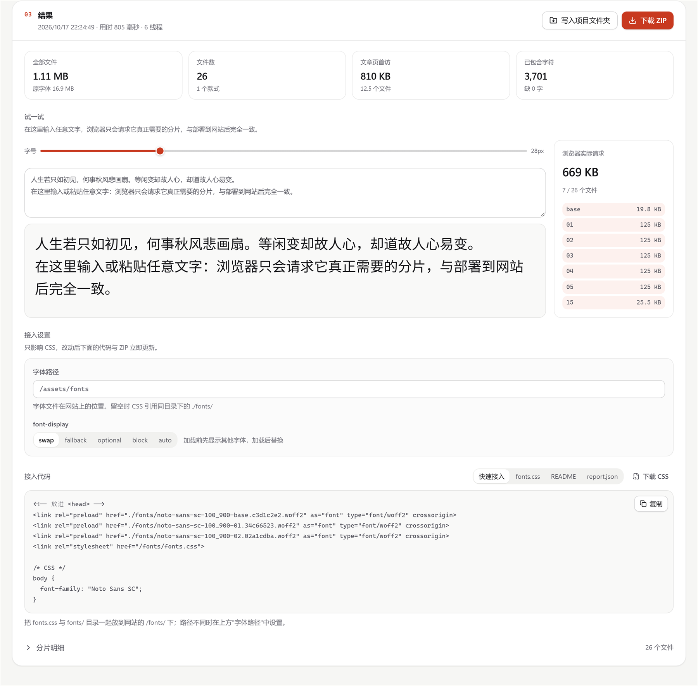

# WebFont Slice

[](LICENSE)

[English](README.md) · **简体中文** · [繁體中文](README.zh-TW.md) · [한국어](README.ko.md) · [日本語](README.ja.md)

把中文、日文、韩文字体切成按需加载的 WOFF2 分片，生成可以直接部署的 `unicode-range` CSS；西文正文字体与代码等宽字体按文字切分，连字与风格集原样保留。完全在浏览器本地运行，字体不会上传。

源代码：<https://github.com/DejavuMoe/webfont-slice>（MIT）


一款 CJK 字体动辄 7–20 MB。WebFont Slice 按真实字频估算每个字出现在页面上的概率，再用动态规划决定切在哪里，让一个页面只下载它真正用到的字形：

| 覆盖范围（Noto Sans SC Variable） |   字数 | 单文件（实测） | 文章页实际下载（实测，1500 字） | 相比单文件 |
| --------------------------------- | -----: | -------------: | ------------------------------: | ---------: |
| 常用（通用规范汉字表一级）        |  3,701 |         945 KB |            810 KB · 12.5 个文件 |       −14% |
| 完整（通用规范汉字表全表）        |  8,306 |        2.13 MB |            868 KB · 14.9 个文件 |       −60% |
| GBK（字表库）                     | 21,124 |        5.37 MB |            879 KB · 15.1 个文件 |       −84% |
| 全部（字体全部字符）              | 30,890 |        7.41 MB |            891 KB · 15.1 个文件 |       −88% |

每页下载量几乎与字符集大小无关：范围从 3 千字扩到 3 万字，文章页只多约 80 KB。数字来自 `pnpm benchmark:planner --measure`——逐片真实子集化后按字频计算期望；方法与更多字体见 [`docs/SHARDING.md`](docs/SHARDING.md)。

### 西文与代码字体

不含汉字的字体（拉丁正文字体、JetBrains Mono / Fira Code 这类代码等宽字体、带图标的 Nerd Font）会被自动识别，覆盖范围换成按 Unicode 区块定义的四档：仅文本、西欧、多语言（加拉丁扩展、希腊、西里尔）、全部。中间两档只取字体自己有的字符，不会冒出成百上千个"缺字"。ASCII 与常用标点进基础片，其余按文字分组装箱——希腊、西里尔、制表符与箭头、私用区图标各自成片，纯英文页面通常只下载基础片。

| 字体（全部字符）     |  字符 | 片数 | 单文件（实测） | 页面通常只下载 |
| -------------------- | ----: | ---: | -------------: | -------------: |
| JetBrains Mono 2.304 | 1,363 |    5 |          55 KB |   19 KB 基础片 |
| Fira Code 6.2        | 1,586 |    6 |          67 KB |   23 KB 基础片 |

等宽字体会被标出。"保留排版特性"开启时（默认）除了 `calt`/`liga` 连字，还保留 `ss01`–`ss20` 风格集与 `cv01`–`cv99` 字符变体，可以在自己的 CSS 里用 `font-feature-settings` 切换；生成的用法示例把等宽字族指向 `code, kbd, samp, pre`，结果页与 `demo.html` 用代码片段预览。

## 三步

1. **拖入字体**：TTF、OTF、WOFF 或 WOFF2，按文件签名识别，单个上限 100 MB；同一字族的多个字重可以一起拖。
2. **选覆盖范围**：语言自动判断；四档阶梯从小到大——仅文本、常用、完整、全部（西文字体为仅文本、西欧、多语言、全部），每档实时显示字数、每页预计下载与文件数。写博客的推荐做法：选"常用"，再把几篇文章粘贴进"你的文本"，文章里的生僻字会自动补上，常用的字会优先加载。
3. **生成并部署**：右侧计划面板显示每页预计下载、请求数与每片加载概率，拖动粒度滑杆实时更新；生成后在页面里输入文字试一试，浏览器只请求命中的分片。下载 ZIP 或直接写入项目文件夹。

```text
<family>-webfont.zip
├─ fonts.css      @font-face + unicode-range，只声明本字体
├─ fonts/         WOFF2 分片，文件名带内容哈希
├─ preload.html   预加载标签
├─ demo.html      观察分片按需加载
├─ report.json    逐片字符、体积与加载概率
└─ README.md      这次生成的部署说明
```

部署方法见 [`docs/DEPLOYMENT.md`](docs/DEPLOYMENT.md)。



## 特点

- **按字频规划分片**：高频字合并成少数几片、中频区切细、长尾按码点装箱；基础字符单独成片并建议预加载。粒度一个滑杆，从"更省流量"到"更少文件"。
- **生成前就知道结果**：体积模型用这款字体的 4 次实测子集化校准，分片总量估算偏差在 ±3.5% 内；每页预计下载与实测相差 −1%～+4%。界面上每个数字都是算出来的。
- **只做切片**：CSS 只声明你上传的字体，不附加任何回退字体或度量覆盖，回退栈由你在自己的 `font-family` 里决定。产物包括内容哈希文件名、预加载标签、部署说明与逐片报告；文件名前缀默认取自字族名，也可以自定义（如 `lxgw-400-87.f73f604a.woff2`）。路径与 `font-display` 只影响 CSS，在结果页改动即时反映到代码与 ZIP。
- **真实的按需加载试玩**：生成后在页面里输入文字，浏览器按 `unicode-range` 只请求命中的分片，界面列出实际请求的文件。
- **覆盖常用字表**：通用规范汉字表、教育部常用国字、香港常用字与 HKSCS、Big5、GB 2312 / GBK / GB 18030、Unicode 区块；简体与繁体各有字频档案。
- **西文与代码字体**：自动识别不含汉字的字体与等宽字体，按文字分片，保留连字、风格集与字符变体。
- **可变字体**：保留可变轴，或从命名实例中挑选只需要的固定款式。
- **多线程**：按字体体积与设备内存选择线程数；17 MB 的 Noto Sans SC Variable 生成 26 片约 1 秒。
- **本地、离线**：没有后端与遥测；PWA 首次访问后可离线使用；中英文界面，浅色/深色主题；手机上有可展开的底部计划面板。

## 隐私与许可

- 没有后端。体检、子集化、WOFF2 编码和打包都在当前页面的 Web Worker 与 WASM 中完成；浏览器只请求应用代码、WASM、字表与字频 JSON 以及 Service Worker 更新。
- `localStorage` 只保存界面偏好和字符/分包/输出设置，**不保存自定义文本**；字体、分片与 ZIP 只存在于内存和你主动下载的位置。
- **本工具不授予任何字体权利。** 子集化通常构成修改，网页部署通常构成嵌入和再分发；许多商业字体禁止这样做，部署前请确认许可。默认的"精简元数据"只删除网页用不到的 `name` 记录，版权、字族、许可说明与链接始终保留。

## 开发

要求 Node.js 24+、pnpm 11.24+。

```bash
corepack enable
pnpm install          # 同时生成本地拆分的 wawoff2 WASM
pnpm dev              # http://localhost:5173
pnpm check            # lint + 架构探针 + 格式 + 单元测试与覆盖率 + 数据校验 + 构建
pnpm test:e2e         # 先构建后运行 Playwright（Chromium 全套，Firefox/WebKit 主流程）
pnpm benchmark:planner path/to/font.ttf --measure
```

`pnpm build` 生成纯静态的 `dist/`，可以部署到任意静态托管，子路径无需额外配置。推送 `master` 后由 Woodpecker CI 构建并以原子符号链接切换发布，见 [`docs/DEPLOYMENT.md`](docs/DEPLOYMENT.md)。

## 非目标

- 服务端、CLI 或构建插件版本（当前只做浏览器应用）。
- TTC/OTC 字体合集拆分（请先导出单个字体）。
- 任意可变轴坐标或子范围、按 `opsz` 自动拆分 family。
- 字形编辑、字体合并，或字体格式转换以外的字体改造。

## 文档

- [`docs/SHARDING.md`](docs/SHARDING.md)：分包模型、目标函数、体积估算、基准与性能
- [`docs/ARCHITECTURE.md`](docs/ARCHITECTURE.md)：分层、状态、界面、Worker 与可变字体
- [`docs/DEPLOYMENT.md`](docs/DEPLOYMENT.md)：部署工具本身与生成的字体
- [`docs/DATA.md`](docs/DATA.md)：字表与字频来源
- [`AGENTS.md`](AGENTS.md)：贡献与编码代理约束
- [`CHANGELOG.md`](CHANGELOG.md)：变更记录

## License

代码采用 [MIT](LICENSE) 许可；第三方依赖、数据与测试字体见 [`NOTICE`](NOTICE)。问题与建议请提交到 [GitHub Issues](https://github.com/DejavuMoe/webfont-slice/issues)。
